# careguidebd-assessment
DevOps Engineer Candidate Assessment Task

## Incident Investigation Walkthrough
### "An error spike appears on the Application dashboard. How do you find the cause using these tools?"

When an on-call engineer receives an `HighHttpErrorRate` alert or observes an error spike in Grafana:

1. **Step 1: Isolate Time and Endpoint in the Application Dashboard**
   * Open the **Application Metrics & Correlated Logs** dashboard (`http://localhost:3000`).
   * Observe the **Error Rate (HTTP 4xx/5xx)** panel to pinpoint the exact start time of the spike (e.g. 14:32:00 UTC).
   * Cross-reference the **Request Rate** panel to see which HTTP path (`/`, `/health`, `/metrics`) is correlating with the failures.

2. **Step 2: Inspect Correlated Structured Logs (Loki Panel)**
   * Directly underneath the metrics graphs on the same screen, review the **Correlated Application Logs** panel.
   * Apply a LogQL filter to isolate errors without leaving the dashboard:
     `{container="devops-service", level="error"}`
   * Expand a log line to read the JSON payload:
     * Check `"status"` (e.g., `500` or `503`).
     * Read `"error"` or stack trace emitted directly by the Pino logger.

3. **Step 3: Correlate with Container Resource Saturation (cAdvisor)**
   * Switch to the **Container Resource Utilization** dashboard.
   * Check the **Memory Usage Relative to Configured Limit (%)** panel.
   * *Assessment:* If memory suddenly peaked at 100% (256MB), the Node.js event loop paused or an internal worker crashed due to an Out-Of-Memory (OOM) kill or event loop lag.

4. **Step 4: Check Underlying Host Health (Node Exporter)**
   * Switch to the **Host OS & Infrastructure** dashboard.
   * Verify if the host machine ran out of disk space (`Host Disk Usage > 80%`) or experienced CPU starvation, which could explain slow I/O or dropped connections.

5. **Step 5: Resolution & Verification**
   * Fix the offending code regression or adjust container resource limits in `docker-compose.monitoring.yml`.
   * Observe the Application dashboard to verify that the Error Rate drops to 0 RPS and p99 latency normalizes below 50ms.

2. **Production Evolution: Moving from Kubeadm to Amazon EKS**
   
      **To run this workload in a production enterprise environment on Amazon EKS, the following changes would be implemented:**
   
              1. Ingress & Traffic Routing (AWS Load Balancer Controller):
                      o	Replace NodePort with an AWS Application Load Balancer (ALB) provisioned automatically via the aws-load-balancer-controller.
                      o	Enable automated SSL/TLS termination with certificates managed through AWS Certificate Manager (ACM).
                      o	Attach AWS WAF (Web Application Firewall) to block DDoS and malicious traffic at the edge.
   
              2. Secrets Management (External Secrets Operator & AWS Secrets Manager):
                      o	Avoid raw Kubernetes Secret objects in Git or etcd.
                      o	Deploy the External Secrets Operator (ESO) to automatically synchronize secrets from AWS Secrets Manager or HashiCorp Vault.
                      o	Secrets are encrypted at rest with AWS KMS customer-managed keys (CMK) and rotated automatically.
       
              3. Node Autoscaling (Karpenter):
                      o	Replace static virtual machines with Karpenter (or Cluster Autoscaler).
                      o	When HPA scales out pod replicas and pending pods occur, Karpenter provisions right-sized, cost-effective EC2 Spot or On-Demand instances in under 45 seconds.
   
              4. IAM Roles for Service Accounts (IRSA / EKS Pod Identity):
                      o	Pods requiring AWS access (e.g. S3, DynamoDB, SQS) should never use static AWS access keys.
                      o	Use EKS Pod Identity or IRSA to bind Kubernetes ServiceAccounts directly to AWS IAM roles using short-lived OIDC tokens.
       
              5. Multi-AZ High Availability & Pod Disruption Budgets:
                      o	Spread pods across multiple AWS Availability Zones using topologySpreadConstraints.
                      o	Implement a PodDisruptionBudget (PDB) ensuring at least minAvailable: 1 during node maintenance or Kubernetes cluster upgrades.

   GitHub Action Pipeline Secreenshot: 

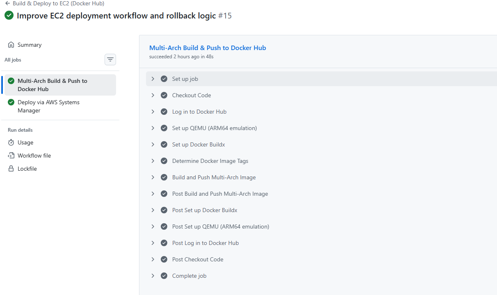
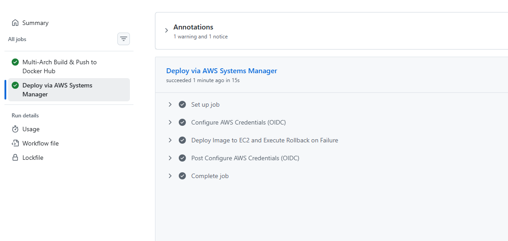
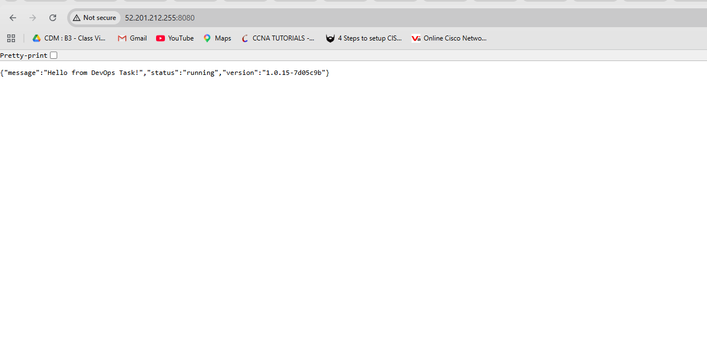
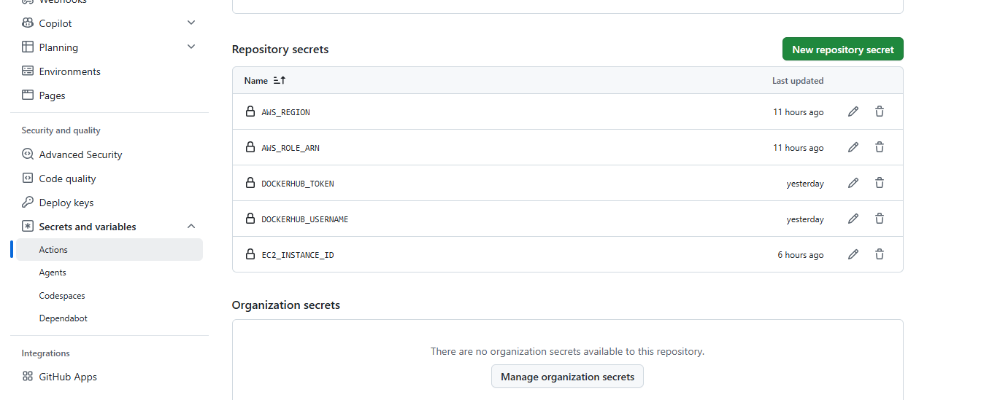
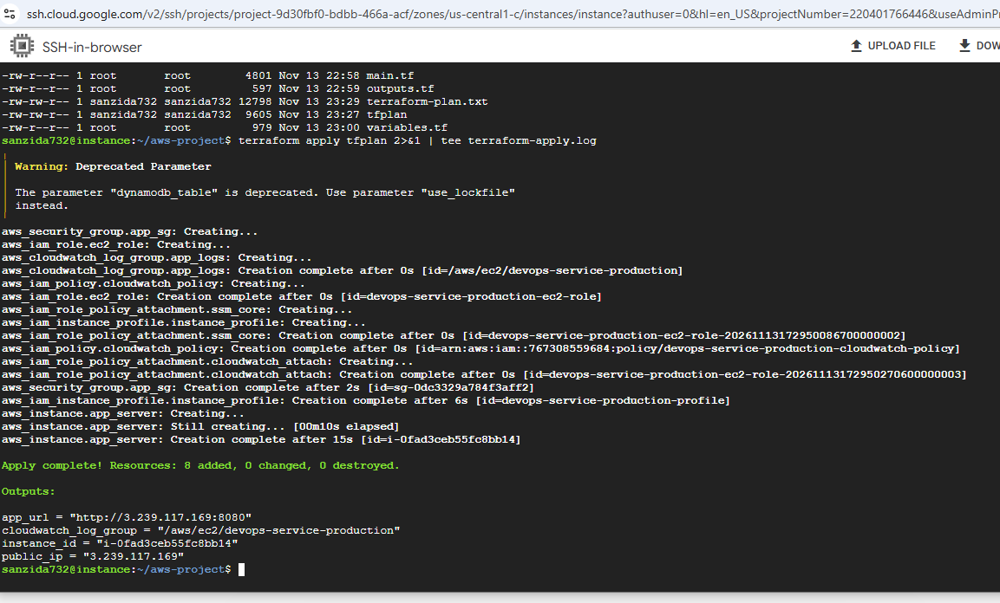
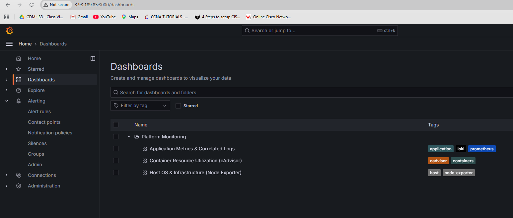
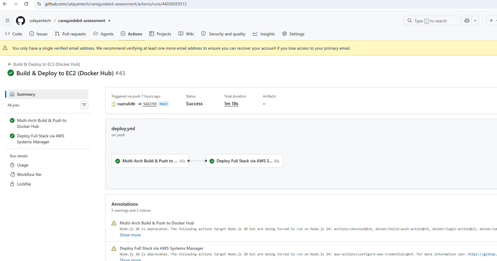
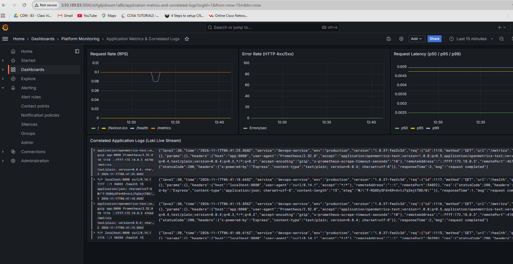
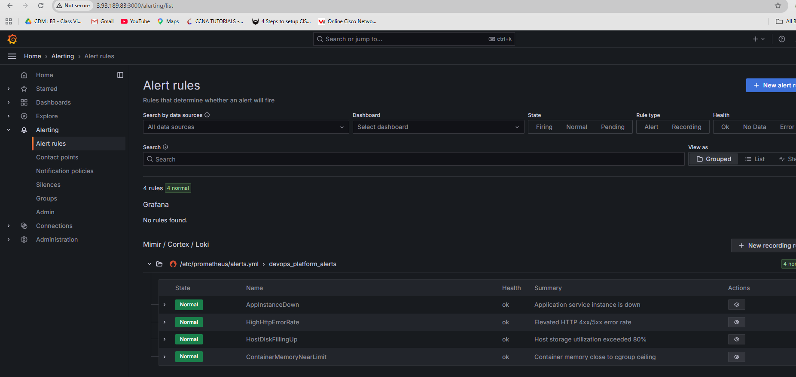
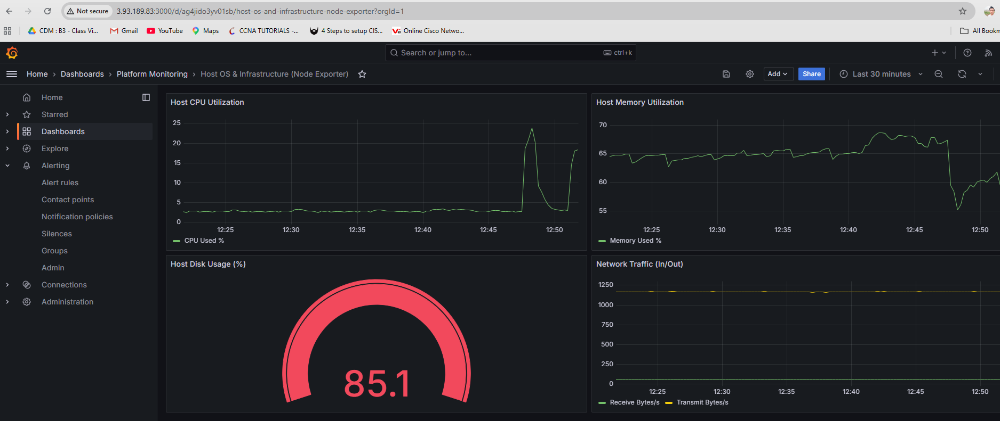
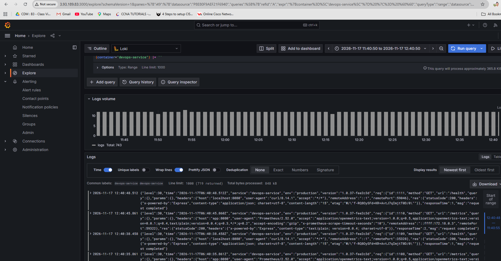
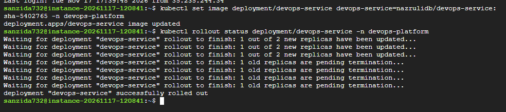
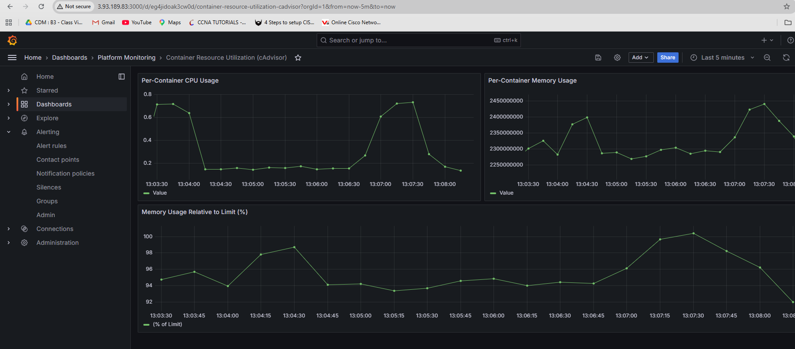
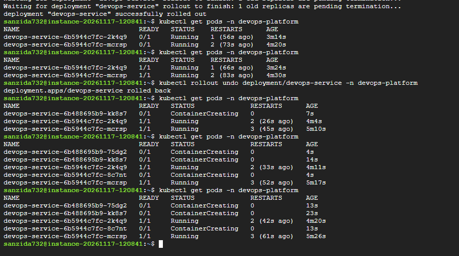
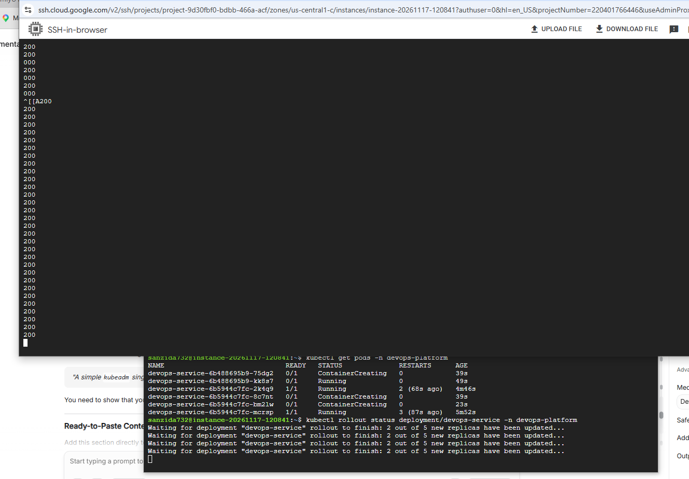

